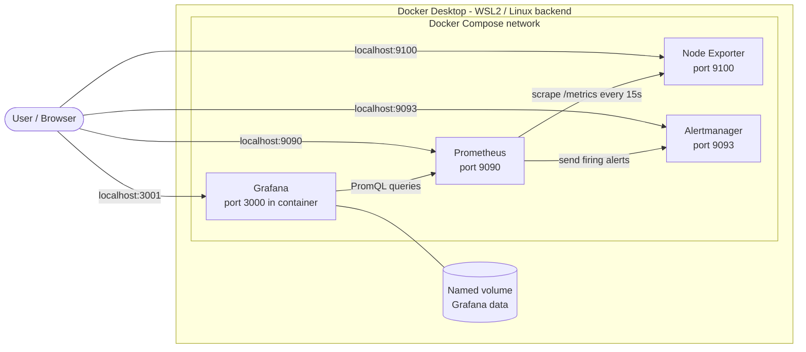
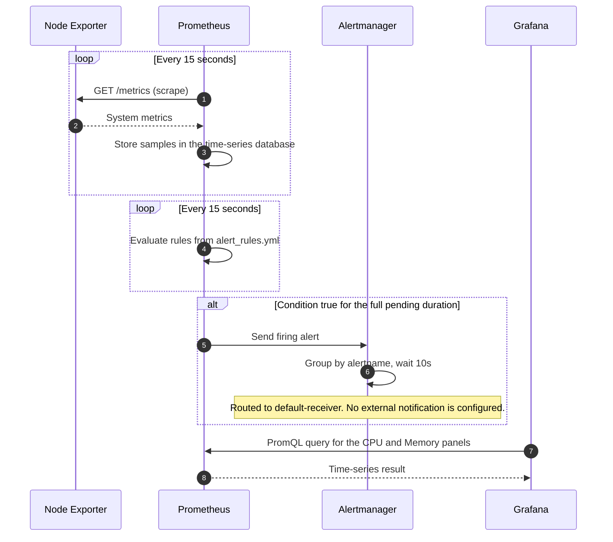
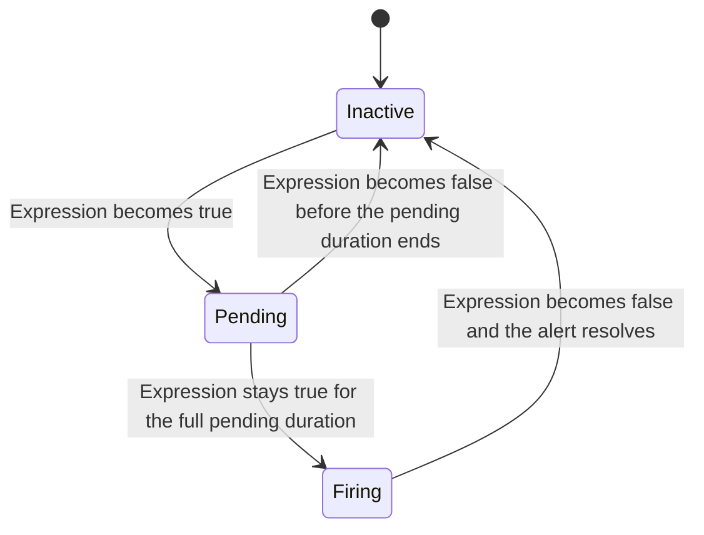
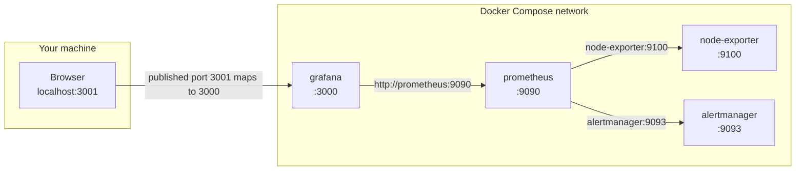
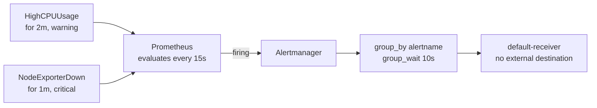
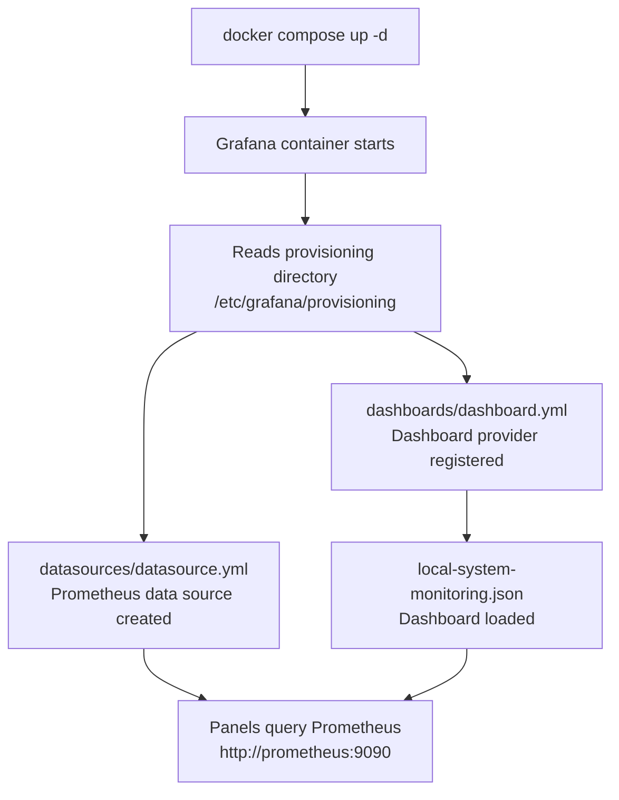

<div align="center">

# Monitoring &amp; Observability Stack

**A containerized Prometheus, Grafana and Alertmanager stack with provisioned dashboards, validated configuration and a tested alert lifecycle, built entirely with Docker Compose.**

<p>
  
  
  
  
  
  
</p>

<a href="https://github.com/ADDYY27/monitoring-stack">GitHub Repository</a>

</div>

---

## 📑 Table of Contents

- [📌 Overview](#-overview)
- [✨ Key Features](#-key-features)
- [🎯 Project Goals](#-project-goals)
- [📐 Architecture](#-architecture)
- [🔬 How It Works](#-how-it-works)
- [🧰 Tech Stack](#-tech-stack)
- [📁 Project Structure](#-project-structure)
- [🔌 Services and Ports](#-services-and-ports)
- [🚀 Installation and Setup](#-installation-and-setup)
- [🔧 Configuration Documentation](#-configuration-documentation)
- [🧮 Prometheus Data Model](#-prometheus-data-model)
- [📊 PromQL Queries](#-promql-queries)
- [📈 Grafana Dashboard](#-grafana-dashboard)
- [🚨 Alerting](#-alerting)
- [🧪 Verified Implementation and Testing](#-verified-implementation-and-testing)
- [🚧 Environment Limitation](#-environment-limitation)
- [🔐 Security Considerations](#-security-considerations)
- [📸 Screenshots](#-screenshots)
- [🧾 Operations Cheat Sheet](#-operations-cheat-sheet)
- [🩺 Troubleshooting](#-troubleshooting)
- [🧠 DevOps Concepts Demonstrated](#-devops-concepts-demonstrated)
- [📚 Key Learnings](#-key-learnings)
- [❓ FAQ](#-faq)
- [🎤 Interview Talking Points](#-interview-talking-points)
- [📖 Glossary](#-glossary)
- [🔮 Future Improvements](#-future-improvements)
- [👤 Author](#-author)

---

## 📌 Overview

This project is a hands-on monitoring and observability environment that runs entirely in Docker. **Node Exporter** exposes system metrics, **Prometheus** scrapes them and stores them as time-series data, **Grafana** visualizes them on a provisioned dashboard, and **Alertmanager** receives alerts from Prometheus whenever an alert rule fires.

Everything is defined as code. Service definitions, scrape targets, alert rules, the Grafana data source and the Grafana dashboard all live in version-controlled YAML and JSON files, so the full stack can be recreated on any machine with Docker using a single command.

### At a Glance

| Item | Value |
|---|---|
| Services | 4 (Prometheus, Node Exporter, Grafana, Alertmanager) |
| Scrape interval | 15 seconds |
| Rule evaluation interval | 15 seconds |
| Alert rules | 2 (`HighCPUUsage`, `NodeExporterDown`) |
| Grafana dashboards | 1 (*Local System Monitoring*, 2 gauge panels) |
| Provisioning | Data source and dashboard, both file-based |
| Validated with | `docker compose config`, `promtool`, `amtool` |
| Developed on | Windows, Docker Desktop with WSL2 / Linux backend |

### Quick Start

```powershell
git clone https://github.com/ADDYY27/monitoring-stack.git
cd monitoring-stack
docker compose up -d
```

Then open Grafana at `http://localhost:3001` and Prometheus at `http://localhost:9090`.

---

## ✨ Key Features

- **Four-service Docker Compose stack** that starts with a single command
- **Prometheus** scraping itself and Node Exporter every 15 seconds
- **Two alert rules** (`HighCPUUsage` and `NodeExporterDown`) evaluated every 15 seconds
- **Alertmanager** with alert grouping, timing controls and a configured default receiver
- **Grafana data source provisioning**, so Prometheus is connected automatically on first start
- **Grafana dashboard provisioning** from JSON, so the *Local System Monitoring* dashboard loads with no manual setup
- **Persistent Grafana storage** using a named Docker volume
- **Pinned image versions** for reproducible deployments
- **Validated configuration** using `promtool` and `amtool`
- **Tested alert lifecycle** for `NodeExporterDown` (Pending, Firing and Resolved)

---

## 🎯 Project Goals

This project was built as a practical way to learn how a complete monitoring pipeline works from end to end, rather than only reading about it. The goals were to:

1. Understand how metrics are exposed, collected, stored and queried.
2. Learn PromQL by building real queries for CPU and memory utilization.
3. Treat monitoring configuration as code: provisioned data sources, provisioned dashboards and version-controlled alert rules.
4. Understand the alert lifecycle (Inactive, Pending, Firing, Resolved) by triggering it on purpose.
5. Practice Docker Compose, container networking and persistent volumes in a realistic multi-service setup.
6. Practice validating configuration and troubleshooting with logs before blaming the tools.

---

## 📐 Architecture

### System Architecture



### Metrics Collection and Alert Data Flow



### Alert Lifecycle



### Container Networking

Containers talk to each other over the Docker Compose network using **service names**. Your browser talks to the stack through **published host ports**.



### Alert Routing



---

## 🔬 How It Works

### The data journey

1. **Exposure.** Node Exporter serves system metrics as plain text at `http://node-exporter:9100/metrics`.
2. **Collection.** Prometheus uses a **pull model**: every 15 seconds it sends an HTTP request to each configured target and reads the metrics. It also scrapes its own `/metrics` endpoint.
3. **Storage.** Each scraped value is stored as a timestamped sample in Prometheus's built-in time-series database.
4. **Evaluation.** Every 15 seconds Prometheus evaluates the expressions in `alert_rules.yml` against the stored data.
5. **Alerting.** When an expression has been true for its full `for:` duration, the alert becomes **Firing** and Prometheus sends it to Alertmanager at `alertmanager:9093`.
6. **Routing.** Alertmanager groups alerts by `alertname`, waits `group_wait` (10s), and routes the group to `default-receiver`.
7. **Visualization.** Grafana runs PromQL queries against Prometheus and renders the results as gauge panels.

### What happens at startup

Grafana is configured entirely from files, so no manual clicking is required after `docker compose up -d`.



### Pull model vs push model

| | Pull (Prometheus) | Push |
|---|---|---|
| Who initiates | The monitoring server requests metrics from targets | Targets send metrics to the server |
| Target health | A failed scrape immediately signals a problem (`up == 0`) | Silence is ambiguous: the target may be down or simply idle |
| Used in this project | Yes | No |

The pull model is exactly what makes the `NodeExporterDown` alert possible: if Prometheus cannot reach the exporter, the `up` metric becomes `0`.

---

## 🧰 Tech Stack

| Technology | Version | Purpose | Documentation |
|---|---|---|---|
| Docker Desktop (WSL2 backend) | Not pinned | Container runtime used for development on Windows | [docs.docker.com](https://docs.docker.com/desktop/) |
| Docker Compose | Not pinned | Defines and runs the multi-container stack | [docs.docker.com/compose](https://docs.docker.com/compose/) |
| Prometheus | `v3.5.0` | Metrics collection, time-series storage, alert rule evaluation | [prometheus.io/docs](https://prometheus.io/docs/introduction/overview/) |
| Node Exporter | `v1.9.1` | Exposes system metrics on `/metrics` | [prometheus.io/docs/guides/node-exporter](https://prometheus.io/docs/guides/node-exporter/) |
| Grafana | `12.1.0` | Dashboards and visualization | [grafana.com/docs](https://grafana.com/docs/grafana/latest/) |
| Alertmanager | `v0.28.1` | Receives, groups and routes alerts | [prometheus.io/docs/alerting](https://prometheus.io/docs/alerting/latest/alertmanager/) |
| PromQL | n/a | Query language for Prometheus metrics | [prometheus.io/docs/prometheus/latest/querying](https://prometheus.io/docs/prometheus/latest/querying/basics/) |
| YAML / JSON | n/a | Configuration as code (services, rules, provisioning, dashboards) | [yaml.org](https://yaml.org/) / [json.org](https://www.json.org/) |

---

## 📁 Project Structure

```text
monitoring-stack/
├── docker-compose.yml                       # Defines the four services, ports, volumes and network
├── prometheus/
│   ├── prometheus.yml                       # Scrape targets, intervals, rule file and Alertmanager endpoint
│   └── alert_rules.yml                      # HighCPUUsage and NodeExporterDown alert rules
├── alertmanager/
│   └── alertmanager.yml                     # Grouping, timing and default receiver
├── grafana/
│   ├── local-system-monitoring.json         # Exported copy of the dashboard
│   └── provisioning/
│       ├── datasources/
│       │   └── datasource.yml               # Provisions Prometheus as the default data source
│       └── dashboards/
│           ├── dashboard.yml                # Tells Grafana where to load dashboard JSON from
│           └── local-system-monitoring.json # Dashboard loaded automatically by Grafana
├── screenshots/                             # Add the images listed under Screenshots (to be added)
├── .gitignore                               # Files excluded from version control
└── README.md                                # Project documentation
```

### File responsibilities at a glance

| Layer | Files | Responsibility |
|---|---|---|
| Orchestration | `docker-compose.yml` | What runs, on which ports, with which mounts |
| Collection | `prometheus/prometheus.yml` | What to scrape and how often |
| Detection | `prometheus/alert_rules.yml` | What counts as a problem |
| Notification | `alertmanager/alertmanager.yml` | What to do when a problem is detected |
| Visualization | `grafana/provisioning/**` | How Grafana connects to data and loads dashboards |

---

## 🔌 Services and Ports

| Service | Image | Container Port | Host Port | Local URL | Purpose |
|---|---|---|---|---|---|
| Prometheus | `prom/prometheus:v3.5.0` | 9090 | 9090 | http://localhost:9090 | Scrapes metrics, stores time series, evaluates alert rules |
| Node Exporter | `prom/node-exporter:v1.9.1` | 9100 | 9100 | http://localhost:9100/metrics | Exposes system metrics for Prometheus |
| Grafana | `grafana/grafana:12.1.0` | 3000 | **3001** | http://localhost:3001 | Dashboards and visualization |
| Alertmanager | `prom/alertmanager:v0.28.1` | 9093 | 9093 | http://localhost:9093 | Receives and groups alerts from Prometheus |

### Understanding the port mapping

A Compose mapping is written as `HOST:CONTAINER`. Grafana's mapping publishes container port `3000` on host port `3001`.

| Used by | Address to use |
|---|---|
| Your browser | `http://localhost:3001` |
| Other containers (for example Prometheus) | `http://grafana:3000` |
| Containers reaching Prometheus (for example Grafana) | `http://prometheus:9090` |

Inside the Compose network, always use the **container port** and the **service name**. The host port only matters from your own machine.

---

## 🚀 Installation and Setup

### Prerequisites

- Docker Desktop with the WSL2 backend (Windows) or Docker Engine with the Compose plugin (Linux)
- Git
- PowerShell (commands below are PowerShell compatible)
- Free host ports: `9090`, `9100`, `3001` and `9093`

### 1. Clone the repository

```powershell
git clone https://github.com/ADDYY27/monitoring-stack.git
```

### 2. Enter the project directory

```powershell
cd monitoring-stack
```

### 3. Validate the Compose configuration

```powershell
docker compose config
```

This parses `docker-compose.yml` and prints the resolved configuration. It reports an error if the file is invalid.

### 4. Start the services

```powershell
docker compose up -d
```

`-d` runs the containers in the background (detached mode).

### 5. Verify the containers

```powershell
docker compose ps
```

All four services (`prometheus`, `node-exporter`, `grafana`, `alertmanager`) should show a running state.

### 6. Access the services

| Service | URL |
|---|---|
| Prometheus | http://localhost:9090 |
| Prometheus targets | http://localhost:9090/targets |
| Prometheus alerts | http://localhost:9090/alerts |
| Node Exporter metrics | http://localhost:9100/metrics |
| Grafana | http://localhost:3001 |
| Alertmanager | http://localhost:9093 |

Grafana's default first-login credentials are `admin` / `admin` unless you have configured different ones. Grafana asks you to change the password after the first login.

### 7. Validate the configuration files (optional)

```powershell
docker compose exec prometheus promtool check config /etc/prometheus/prometheus.yml
docker compose exec prometheus promtool check rules /etc/prometheus/alert_rules.yml
docker compose exec alertmanager amtool check-config /etc/alertmanager/alertmanager.yml
```

> The paths above assume the standard in-container locations. Adjust them if the volume mounts in `docker-compose.yml` use different paths.

### 8. Stop the services

```powershell
docker compose down
```

### 9. Remove the stack and its volumes

```powershell
docker compose down -v
```

### `docker compose down` vs `docker compose down -v`

| Command | Containers | Network | Named volumes |
|---|---|---|---|
| `docker compose down` | Removed | Removed | **Kept**. Grafana data survives, so the next `up` restores it |
| `docker compose down -v` | Removed | Removed | **Deleted**. Grafana's stored data is lost |

Use `down` for normal shutdowns. Use `down -v` only when you want a completely clean slate. The provisioned data source and dashboard are recreated from the files in this repository on the next start, but anything created manually in the Grafana UI is lost.

### Applying configuration changes

| You changed | Run |
|---|---|
| `prometheus.yml` or `alert_rules.yml` | `docker compose restart prometheus` |
| `alertmanager.yml` | `docker compose restart alertmanager` |
| Grafana provisioning files | `docker compose restart grafana` |
| `docker-compose.yml` (ports, images, mounts) | `docker compose up -d` |

Validate with `promtool` or `amtool` **before** restarting, so a typo does not take a service down.

---

## 🔧 Configuration Documentation

### `docker-compose.yml`

Defines the four services with pinned image versions, the port mappings listed above, the mounts for configuration files, and a named volume for Grafana data.

**Design choices:**

| Choice | Reason |
|---|---|
| Pinned image tags (for example `prom/prometheus:v3.5.0`) | Reproducible: the stack behaves the same today and six months from now |
| Shared Compose network | Services resolve each other by name, so no IP addresses are hard-coded |
| Config files mounted from the repository | Configuration stays in Git and can be edited without rebuilding any image |
| Named volume for Grafana | Grafana data survives container recreation |

### `prometheus/prometheus.yml`

Controls how Prometheus collects data and where it sends alerts.

| Setting | Value |
|---|---|
| Scrape interval | 15 seconds |
| Evaluation interval | 15 seconds |
| Scrape targets | `prometheus:9090`, `node-exporter:9100` |
| Rule file | `alert_rules.yml` |
| Alertmanager endpoint | `alertmanager:9093` |

```yaml
# Simplified excerpt showing the structure
global:
  scrape_interval: 15s
  evaluation_interval: 15s

rule_files:
  - alert_rules.yml

alerting:
  alertmanagers:
    - static_configs:
        - targets: ["alertmanager:9093"]
```

### `prometheus/alert_rules.yml`

Contains exactly two alert rules, described in detail under [Alerting](#-alerting).

```yaml
# Excerpt: structure of the HighCPUUsage rule
- alert: HighCPUUsage
  expr: 100 - (avg by(instance) (rate(node_cpu_seconds_total{mode="idle"}[2m])) * 100) > 80
  for: 2m
  labels:
    severity: warning
```

```yaml
# Excerpt: structure of the NodeExporterDown rule
- alert: NodeExporterDown
  expr: up{job="node-exporter"} == 0
  for: 1m
  labels:
    severity: critical
```

### `alertmanager/alertmanager.yml`

Controls how incoming alerts are grouped and which receiver handles them.

```yaml
# Simplified excerpt of the effective settings
global:
  resolve_timeout: 5m
route:
  group_by: ['alertname']
  group_wait: 10s
  group_interval: 30s
  repeat_interval: 1h
  receiver: default-receiver
```

`default-receiver` has no external destination configured. See [Future Improvements](#-future-improvements).

### `grafana/provisioning/datasources/datasource.yml`

Registers Prometheus as Grafana's default data source at `http://prometheus:9090`. It uses the Compose service name rather than `localhost`, because Grafana runs in its own container and `localhost` would refer to Grafana itself.

### `grafana/provisioning/dashboards/dashboard.yml`

A dashboard provider that tells Grafana to load dashboards from files. The provisioning path inside the Grafana container is:

```text
/etc/grafana/provisioning/dashboards
```

### `grafana/provisioning/dashboards/local-system-monitoring.json`

The dashboard definition that Grafana loads automatically at startup. An exported copy is also kept at `grafana/local-system-monitoring.json`.

### `.gitignore`

Keeps files that should not be version-controlled out of the repository.

---

## 🧮 Prometheus Data Model

Prometheus stores everything as **time series**: a metric name plus a set of key/value **labels**, with a timestamped value at each scrape.

```text
node_cpu_seconds_total{cpu="0", mode="idle", instance="node-exporter:9100", job="node-exporter"}  123456.78
└────── metric name ─────┘└──────────────────────────── labels ─────────────────────────────────┘  └ value ┘
```

### Metric types used in this project

| Type | Meaning | Example here |
|---|---|---|
| **Counter** | A value that only goes up (or resets to 0 on restart). Useful through `rate()` | `node_cpu_seconds_total` |
| **Gauge** | A value that can go up and down | `node_memory_MemAvailable_bytes`, `node_memory_MemTotal_bytes` |

### Key metrics used

| Metric | Type | Description | Used in |
|---|---|---|---|
| `node_cpu_seconds_total` | Counter | Seconds each CPU core has spent in each mode (idle, user, system, and others) | CPU gauge, `HighCPUUsage` |
| `node_memory_MemAvailable_bytes` | Gauge | Memory available for starting new applications | Memory gauge |
| `node_memory_MemTotal_bytes` | Gauge | Total memory | Memory gauge |
| `up` | Gauge | Generated by Prometheus for every target: `1` if the last scrape succeeded, `0` if it failed | `NodeExporterDown` |

### Why `rate()` is needed for counters

A counter such as `node_cpu_seconds_total` only ever grows, so its raw value says little. `rate(metric[2m])` calculates the per-second increase averaged over the last 2 minutes. For idle CPU time, that rate is the **fraction of time the CPU was idle**.

---

## 📊 PromQL Queries

### CPU usage (%)

```promql
100 * (1 - avg by(instance) (rate(node_cpu_seconds_total{mode="idle"}[2m])))
```

1. `node_cpu_seconds_total{mode="idle"}` is a counter of the seconds each CPU core has spent idle.
2. `rate(...[2m])` converts that counter into a per-second rate over the last 2 minutes. This gives the fraction of time each core was idle.
3. `avg by(instance)` averages the idle fraction across all cores of an instance.
4. `1 - ...` flips idle time into busy time.
5. `100 * ...` expresses the result as a percentage.

**Worked example:** if the cores were idle 85% of the time over the last 2 minutes, the query returns `100 * (1 - 0.85) = 15`, meaning 15% CPU usage.

### Memory usage (%)

```promql
100 * (1 - (node_memory_MemAvailable_bytes / node_memory_MemTotal_bytes))
```

1. `node_memory_MemAvailable_bytes / node_memory_MemTotal_bytes` is the fraction of memory still available.
2. `1 - ...` converts it to the fraction in use.
3. `100 * ...` expresses it as a percentage.

**Worked example:** with 8 GiB total and 2 GiB available, the fraction available is `0.25`, so memory usage is `100 * (1 - 0.25) = 75`.

### Useful additional queries

**Node Exporter availability** (`1` means up, `0` means down):

```promql
up{job="node-exporter"}
```

**Health of all targets:**

```promql
up
```

**Number of healthy targets:**

```promql
count(up == 1)
```

**CPU utilization over a longer 5-minute window** (smoother, less sensitive to short spikes):

```promql
100 * (1 - avg by(instance) (rate(node_cpu_seconds_total{mode="idle"}[5m])))
```

### Exploratory queries (not part of the dashboard)

These are standard Node Exporter queries you can try in the Prometheus UI. They are **not** used by the dashboard or alert rules, and their results depend on what the Docker environment exposes (see [Environment Limitation](#-environment-limitation)).

| Goal | Query |
|---|---|
| Memory used in bytes | `node_memory_MemTotal_bytes - node_memory_MemAvailable_bytes` |
| 1-minute load average | `node_load1` |
| System uptime in seconds | `time() - node_boot_time_seconds` |
| Network receive rate | `rate(node_network_receive_bytes_total[5m])` |
| Network transmit rate | `rate(node_network_transmit_bytes_total[5m])` |
| Filesystem usage (%) | `100 * (1 - (node_filesystem_avail_bytes{fstype!~"tmpfs\|overlay"} / node_filesystem_size_bytes{fstype!~"tmpfs\|overlay"}))` |
| Scrape duration per target | `scrape_duration_seconds` |

---

## 📈 Grafana Dashboard

The **Local System Monitoring** dashboard contains two gauge panels:

| Panel | Query |
|---|---|
| CPU Usage (%) | `100 * (1 - avg by(instance) (rate(node_cpu_seconds_total{mode="idle"}[2m])))` |
| Memory Usage (%) | `100 * (1 - (node_memory_MemAvailable_bytes / node_memory_MemTotal_bytes))` |

### How it is wired up

- **Prometheus data source:** provisioned from `datasource.yml`, so no manual setup is needed.
- **Automatic provisioning:** `dashboard.yml` points Grafana at `/etc/grafana/provisioning/dashboards`, and Grafana loads the dashboard JSON found there at startup.
- **Dashboard JSON:** the dashboard is managed as a file (`local-system-monitoring.json`), so changes can be reviewed and versioned in Git like any other code.
- **Persistent volume:** Grafana's data directory is stored in a named Docker volume, so Grafana data survives `docker compose down`. The volume is removed only by `docker compose down -v`.

### Why two copies of the dashboard JSON?

| File | Role |
|---|---|
| `grafana/provisioning/dashboards/local-system-monitoring.json` | The copy Grafana actually loads at startup |
| `grafana/local-system-monitoring.json` | The exported copy kept alongside the project |

### Updating the dashboard

1. Edit the dashboard in the Grafana UI at http://localhost:3001.
2. Export it as JSON from the dashboard's share/export option.
3. Replace `grafana/provisioning/dashboards/local-system-monitoring.json` (and the exported copy) with the new JSON.
4. Restart Grafana with `docker compose restart grafana` and confirm the dashboard loads.
5. Commit the updated JSON to Git.

---

## 🚨 Alerting

### Alert rules

| Alert | Expression | Pending duration | Severity | Summary |
|---|---|---|---|---|
| `HighCPUUsage` | `100 - (avg by(instance) (rate(node_cpu_seconds_total{mode="idle"}[2m])) * 100) > 80` | 2 minutes | warning | High CPU usage detected |
| `NodeExporterDown` | `up{job="node-exporter"} == 0` | 1 minute | critical | Node Exporter is down |

- **HighCPUUsage** fires when average CPU utilization stays above 80% for 2 minutes.
- **NodeExporterDown** fires when Prometheus cannot scrape the Node Exporter target for 1 minute.

### Why these two alerts?

They cover two different failure categories:

| Category | Alert | Question it answers |
|---|---|---|
| **Resource saturation** | `HighCPUUsage` | Is the system overloaded? |
| **Availability** | `NodeExporterDown` | Is the thing that reports health still reachable at all? |

### Pending and Firing states

| State | Meaning |
|---|---|
| Inactive | The expression is false. Nothing is wrong |
| Pending | The expression is true, but has not yet been true for the full pending duration |
| Firing | The expression has been true for the full pending duration. Prometheus sends the alert to Alertmanager |

The pending duration (`for:`) prevents short, harmless spikes from triggering alerts. See the [alert lifecycle diagram](#alert-lifecycle).

### Expected timeline for `NodeExporterDown`

| Time after stopping Node Exporter | What happens |
|---|---|
| 0s | Node Exporter stops. The next scrape fails and `up` becomes `0` (within about 15s) |
| Within about 15s | The rule expression becomes true and the alert enters **Pending** |
| About 1 minute later | The `for: 1m` duration is satisfied and the alert becomes **Firing** |
| A few seconds after firing | Alertmanager receives the alert and groups it (`group_wait: 10s`) |
| After restarting Node Exporter | The next scrape succeeds, `up` returns to `1`, and the alert resolves |

Exact timings vary slightly because scrapes and rule evaluations are not synchronized.

### Alertmanager grouping and routing

| Setting | Value | Effect |
|---|---|---|
| `group_by` | `alertname` | Alerts with the same name are grouped into one notification group |
| `group_wait` | 10s | Initial wait to collect related alerts before the first notification |
| `group_interval` | 30s | Wait before notifying about new alerts added to an existing group |
| `repeat_interval` | 1h | How often an unresolved alert is re-sent |
| `resolve_timeout` | 5m | Time after which an alert without an end time is treated as resolved |
| `receiver` | `default-receiver` | The receiver all alerts are routed to |

> **Note:** No email, Slack, Telegram or webhook destination is configured, so no external notification is delivered. Alerts are visible in the Prometheus and Alertmanager web interfaces.

### Testing the `NodeExporterDown` alert

1. Stop Node Exporter:

   ```powershell
   docker compose stop node-exporter
   ```

2. Open http://localhost:9090/alerts and watch `NodeExporterDown` move from **Inactive** to **Pending**, then to **Firing** after about a minute.
3. Open http://localhost:9093 and confirm the alert appears in Alertmanager.
4. Start Node Exporter again:

   ```powershell
   docker compose start node-exporter
   ```

5. Refresh http://localhost:9090/alerts and confirm the alert returns to **Inactive** (resolved).

> `HighCPUUsage` has been validated for syntax but has **not** been manually load-tested.

---

## 🧪 Verified Implementation and Testing

### Checklist

- [x] Docker Compose configuration validated
- [x] All four containers started successfully
- [x] Prometheus and Node Exporter targets showed **UP**
- [x] Grafana Prometheus data source *Save & Test* succeeded
- [x] Custom Grafana CPU and Memory gauge panels created
- [x] Dashboard exported to JSON
- [x] Dashboard provisioning configured
- [x] Grafana restarted and the dashboard loaded automatically
- [x] Prometheus alert rules validated with `promtool`
- [x] Alertmanager configuration validated with `amtool`
- [x] `NodeExporterDown` tested manually by stopping Node Exporter
- [x] Alert entered the **FIRING** state
- [x] Node Exporter restarted and the alert recovered
- [x] Project pushed to GitHub

### Test summary

| Area | Method | Result |
|---|---|---|
| Compose file | `docker compose config` | Valid |
| Container startup | `docker compose up -d`, `docker compose ps` | All four services started |
| Scrape targets | Prometheus **Status > Targets** | `prometheus` and `node-exporter` showed UP |
| Data source | Grafana *Save & Test* | Succeeded |
| Dashboard persistence | Restarted Grafana | Dashboard loaded automatically from provisioning |
| Alert rules | `promtool` | Validated |
| Alertmanager config | `amtool` | Validated |
| `NodeExporterDown` | Stopped and restarted Node Exporter | Entered FIRING, then recovered |

### Not yet verified

- A manual load test of `HighCPUUsage`
- Delivery of external notifications (none is configured)

---

## 🚧 Environment Limitation

This project was developed on **Windows using Docker Desktop with the WSL2 / Linux backend**. Node Exporter runs inside the Docker environment, so the metrics it exposes describe the Linux environment visible to its container. They are **not** a complete view of the Windows host itself.

The stack is fully functional for learning, demonstration and validating Prometheus, Grafana and Alertmanager workflows. Complete host-level monitoring would require running Node Exporter directly on a Linux host or virtual machine, or using a Windows-specific exporter.

---

## 🔐 Security Considerations

This stack is designed for **local learning and demonstration**. Before using a similar setup anywhere beyond a personal machine, keep the following in mind.

| Area | Current state | Recommendation |
|---|---|---|
| Grafana credentials | Grafana's default `admin` / `admin` first-login credentials apply unless changed | Change the password on first login and avoid default credentials on shared networks |
| Published ports | Ports `9090`, `9100`, `3001` and `9093` are published on the host | On a shared or cloud machine, restrict access with a firewall or bind ports to `127.0.0.1` |
| Authentication on Prometheus and Alertmanager | None configured | Put them behind a reverse proxy with authentication for non-local use |
| Transport encryption | HTTP only | Use TLS through a reverse proxy for non-local use |
| Secrets in the repository | None. No external notification receiver is configured | When adding email or webhook receivers, keep credentials out of Git (for example with an `.example` file and `.gitignore`) |
| Image versions | Pinned to specific tags | Review and update tags periodically to pick up security fixes |

These are recommendations, not features of the current implementation.

---

## 📸 Screenshots

The following images are **placeholders that still need to be captured and added** to the `screenshots/` folder:

| Image | What to capture | Status |
|---|---|---|
| `screenshots/grafana-dashboard.png` | Local System Monitoring dashboard with the CPU and Memory gauges | 📌 To be added |
| `screenshots/prometheus-targets.png` | Prometheus **Status > Targets** page with both targets UP | 📌 To be added |
| `screenshots/prometheus-alerts.png` | Prometheus **Alerts** page, ideally showing `NodeExporterDown` in Firing | 📌 To be added |
| `screenshots/alertmanager.png` | Alertmanager UI showing the received alert | 📌 To be added |

Once the files exist, replace this section's table with the image links below (they are commented out so the README does not show broken images):

<!--
### Grafana Dashboard Preview


### Prometheus Targets Preview


### Prometheus Alerts Preview


### Alertmanager Preview

-->

---

## 🧾 Operations Cheat Sheet

| Task | Command |
|---|---|
| Validate the Compose file | `docker compose config` |
| Start everything in the background | `docker compose up -d` |
| Show service status | `docker compose ps` |
| Show logs for one service | `docker compose logs prometheus` |
| Follow logs live | `docker compose logs -f grafana` |
| Restart one service | `docker compose restart grafana` |
| Stop one service | `docker compose stop node-exporter` |
| Start one service | `docker compose start node-exporter` |
| Stop and remove containers (keep volumes) | `docker compose down` |
| Stop and remove containers and volumes | `docker compose down -v` |
| Validate Prometheus config | `docker compose exec prometheus promtool check config /etc/prometheus/prometheus.yml` |
| Validate alert rules | `docker compose exec prometheus promtool check rules /etc/prometheus/alert_rules.yml` |
| Validate Alertmanager config | `docker compose exec alertmanager amtool check-config /etc/alertmanager/alertmanager.yml` |
| Open a shell in a container | `docker compose exec prometheus sh` |
| List published ports in use on Windows | `netstat -ano \| findstr :9090` |

---

## 🩺 Troubleshooting

### Quick diagnosis table

| Symptom | Likely cause | First thing to check |
|---|---|---|
| A container exits right after starting | Invalid YAML, wrong mount path or port conflict | `docker compose logs <service>` |
| `docker compose up` reports a port is already allocated | Another process uses the host port | `netstat -ano \| findstr :<port>` |
| Prometheus target shows DOWN | Target stopped, wrong name or network problem | http://localhost:9090/targets error message |
| Grafana data source test fails | Wrong URL (often `localhost`) | URL must be `http://prometheus:9090` |
| Dashboard missing in Grafana | Provisioning path or JSON problem | `docker compose logs grafana` |
| No alerts visible | Rule file not loaded or rule has a syntax error | `promtool check rules` |

### Checking Docker logs

```powershell
docker compose logs prometheus
docker compose logs grafana
docker compose logs alertmanager
docker compose logs node-exporter

# Follow logs live
docker compose logs -f grafana
```

### A container is not starting

```powershell
docker compose ps -a      # find the service in an Exited state
docker compose logs <service>
docker compose config     # catches YAML and syntax errors
```

Most startup failures come from invalid YAML, a wrong mount path, or a port that is already in use.

### Prometheus target shows DOWN

1. Open http://localhost:9090/targets and read the error message beside the target.
2. Check that the target container is running with `docker compose ps`.
3. Confirm the target name matches the service name in `prometheus.yml` (`node-exporter:9100`).
4. Test connectivity from inside the Prometheus container:

   ```powershell
   docker compose exec prometheus wget -qO- http://node-exporter:9100/metrics
   ```

### Grafana data source connection fails

- The data source URL must be `http://prometheus:9090`. Do **not** use `localhost`, because Grafana runs in a separate container.
- Confirm Prometheus is running at http://localhost:9090.
- Check `docker compose logs grafana` for provisioning errors.

### Dashboard is not loading

- Confirm `dashboard.yml` and `local-system-monitoring.json` are mounted at `/etc/grafana/provisioning/dashboards`.
- Make sure the dashboard JSON is valid.
- Restart Grafana to reload provisioning:

  ```powershell
  docker compose restart grafana
  ```

### Provisioning issues

```powershell
docker compose logs grafana | Select-String -Pattern "provisioning"
```

Look for messages about invalid YAML or an incorrect provisioning path.

### Port conflicts

```powershell
netstat -ano | findstr :9090
netstat -ano | findstr :3001
```

If another process is using a port, stop that process or change the **host** port in the `ports:` section of `docker-compose.yml` (the left-hand side of the mapping), then run `docker compose up -d` again.

### Alert never leaves Pending

This is normal until the `for:` duration has passed. `NodeExporterDown` needs the condition to be true for 1 minute, and `HighCPUUsage` for 2 minutes. If an alert returns to Inactive before that, the condition stopped being true in time.

---

## 🧠 DevOps Concepts Demonstrated

| Concept | How this project demonstrates it |
|---|---|
| **Containerization** | Every component runs as an isolated Docker container with a pinned image version |
| **Docker Compose orchestration** | One file defines and starts the whole multi-service stack |
| **Docker networking** | Services reach each other by service name on a shared Compose network |
| **Prometheus scraping** | Prometheus pulls metrics from targets every 15 seconds |
| **Exporters** | Node Exporter converts system information into the Prometheus metrics format |
| **Time-series database** | Prometheus stores every scraped sample with a timestamp |
| **PromQL** | CPU, memory and availability are calculated with PromQL queries |
| **Grafana visualization** | Gauge panels display live CPU and memory usage |
| **Configuration as Code** | Services, targets, rules, data source and dashboard are all version-controlled files |
| **Dashboard provisioning** | The dashboard is loaded from JSON automatically, with no manual UI setup |
| **Alert rules** | Threshold and availability conditions are defined in `alert_rules.yml` |
| **Alertmanager** | Alerts are grouped and routed through a configured receiver |
| **Persistent volumes** | Grafana data survives container restarts and `docker compose down` |
| **Configuration validation** | `promtool` and `amtool` check configuration before it is applied |
| **Troubleshooting** | Logs, targets pages and validators are used to diagnose problems |
| **Git and GitHub** | The project is version-controlled and published on GitHub |

---

## 📚 Key Learnings

- **Pull-based monitoring makes availability alerts simple.** Because Prometheus initiates each scrape, a failed scrape directly produces `up == 0`.
- **`for:` is what separates a spike from an incident.** Watching an alert sit in Pending before Firing made the purpose of the pending duration clear.
- **Containers must use service names, not `localhost`.** The Grafana data source works with `http://prometheus:9090` because each container has its own `localhost`.
- **Published ports and container ports are different things.** Grafana is reached on host port `3001` from the browser, while containers reach it on `3000`.
- **Provisioning beats clicking.** A dashboard defined as JSON can be reviewed, versioned and restored automatically.
- **`down` and `down -v` are very different.** The second one deletes named volumes, so it should be a deliberate choice.
- **Validate before you restart.** `promtool` and `amtool` catch configuration mistakes before they cause an outage.
- **Know what your exporter can actually see.** Running Node Exporter in Docker on Windows limits which host it describes.

---

## ❓ FAQ

**Does this send email, Slack or webhook notifications?**
No. Alertmanager has a default receiver with no external destination. Alerts are visible in the Prometheus and Alertmanager interfaces. Notification integration is listed under [Future Improvements](#-future-improvements).

**Why does Grafana use port 3001 instead of 3000?**
The host port is mapped to 3001 while Grafana still listens on 3000 inside its container. Use `http://localhost:3001` from your browser and `http://grafana:3000` from other containers.

**Does this monitor my entire Windows machine?**
No. Node Exporter reports on the Linux environment visible to its container. See [Environment Limitation](#-environment-limitation).

**Why are there two copies of the dashboard JSON?**
One is the file Grafana loads through provisioning, and the other is the exported copy kept with the project. See [Grafana Dashboard](#-grafana-dashboard).

**Will I lose my dashboard if I run `docker compose down`?**
No. The named volume is kept, and the dashboard is also recreated from the provisioning JSON on every start.

**Is the `HighCPUUsage` alert tested?**
Its syntax is validated with `promtool`, but it has not been manually load-tested yet. `NodeExporterDown` has been tested end to end.

**Can I add more targets?**
Yes. Add another job or target under `scrape_configs` in `prometheus/prometheus.yml`, validate with `promtool`, and restart Prometheus.

**How long does Prometheus keep data?**
Retention and persistence for Prometheus data are controlled by its startup flags and volume configuration in `docker-compose.yml`. Only Grafana's named volume is documented in this README.

---

## 🎤 Interview Talking Points

Short answers grounded in what this project actually implements.

**What does this project do?**
It runs Prometheus, Node Exporter, Grafana and Alertmanager with Docker Compose. Prometheus scrapes metrics every 15 seconds, Grafana shows CPU and memory gauges from a provisioned dashboard, and two alert rules feed Alertmanager.

**What is the difference between Prometheus and Grafana?**
Prometheus collects, stores and queries metrics and evaluates alert rules. Grafana only visualizes data it queries from Prometheus.

**What is Node Exporter and why is it needed?**
It is an exporter that exposes system metrics in the format Prometheus understands. Prometheus does not read operating system metrics by itself, so an exporter translates them.

**Pull or push, and why does it matter?**
Prometheus pulls. A failed scrape immediately sets `up` to `0`, which is how `NodeExporterDown` works.

**Explain your CPU query.**
`node_cpu_seconds_total{mode="idle"}` counts idle seconds. `rate` turns it into the idle fraction, `avg by(instance)` averages across cores, and `100 * (1 - idle)` gives usage as a percentage.

**What does `for: 2m` do?**
The condition must stay true for 2 minutes before the alert fires. Until then it is Pending. This avoids alerting on short spikes.

**What is the difference between Pending and Firing?**
Pending means the expression is true but the `for:` duration has not elapsed. Firing means it has, and Prometheus sends the alert to Alertmanager.

**What does Alertmanager do that Prometheus does not?**
Prometheus decides when an alert fires. Alertmanager groups, deduplicates and routes alerts to receivers.

**What is dashboard provisioning?**
Grafana loads dashboards and data sources from files at startup. It makes the setup reproducible and version-controllable.

**Why does the Grafana data source use `http://prometheus:9090`?**
Grafana runs in its own container, so `localhost` would point to Grafana itself. Docker Compose lets containers reach each other by service name.

**How did you test your alerting?**
I stopped the Node Exporter container, watched `NodeExporterDown` go from Pending to Firing, confirmed it in Alertmanager, restarted the container and confirmed the alert recovered.

**What are the limitations of this project?**
It runs on Docker Desktop with WSL2, so it does not provide full Windows host monitoring. There are no external notifications configured, and `HighCPUUsage` has not been load-tested yet.

**What would you improve next?**
Email notifications through Alertmanager, disk alerts, more dashboard panels, application metrics, centralized logging with Loki, and CI/CD validation of the configuration files.

---

## 📖 Glossary

| Term | Meaning |
|---|---|
| **Alertmanager** | Component that receives alerts from Prometheus, groups them and routes them to receivers |
| **Counter** | A metric that only increases (or resets to zero), usually used with `rate()` |
| **Dashboard provisioning** | Loading Grafana dashboards from files at startup |
| **Exporter** | A program that exposes metrics from another system in Prometheus format |
| **Firing** | Alert state in which the condition has been true for the full `for:` duration |
| **Gauge** | A metric whose value can go up and down |
| **Instance** | The address of a scrape target, such as `node-exporter:9100` |
| **Job** | A named group of targets in the Prometheus scrape configuration |
| **Label** | A key/value pair attached to a metric that identifies a specific series |
| **Named volume** | Docker-managed persistent storage that outlives containers |
| **Pending** | Alert state in which the condition is true but the `for:` duration has not elapsed |
| **PromQL** | Prometheus Query Language |
| **Scrape** | One request from Prometheus to a target to collect its metrics |
| **Time-series database** | A database optimized for values stored with timestamps |
| **WSL2** | Windows Subsystem for Linux 2, the Linux backend used by Docker Desktop on Windows |

---

## 🔮 Future Improvements

These are **planned enhancements and are not implemented yet**.

### Alerting

- [ ] Email notification integration through Alertmanager
- [ ] Disk utilization alerting
- [ ] Manual load test of the `HighCPUUsage` alert
- [ ] Review and document alert severity routing

### Dashboards

- [ ] Additional CPU, memory, disk and network panels where supported
- [ ] Time-series (graph) panels alongside the existing gauges

### Platform and automation

- [ ] Cloud deployment
- [ ] CI/CD automation, for example validating configuration with `promtool` and `amtool` on every push
- [ ] Review and document Prometheus data persistence and retention

### Observability scope

- [ ] Application monitoring
- [ ] Grafana Loki integration for centralized logging

---

## 👤 Author

**Adarsh Dubey**

- GitHub: [@ADDYY27](https://github.com/ADDYY27)
- Project: [monitoring-stack](https://github.com/ADDYY27/monitoring-stack)

---

<div align="center">

*If you find this project useful, consider giving it a star.*

</div>
